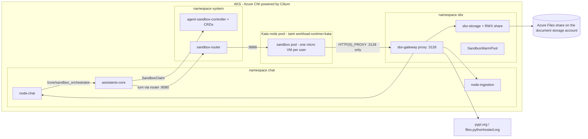
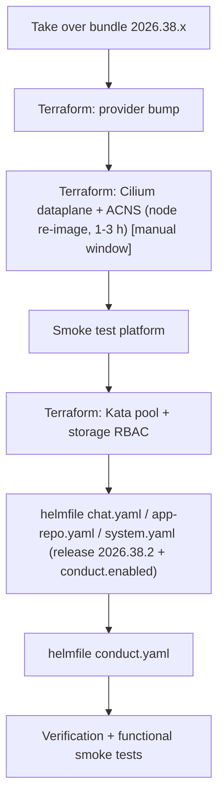

# Unique AI Conduct on the legacy CMT stack - handbook

This handbook describes what has to happen on a customer-managed tenant (CMT) that runs the legacy
helmfile/terraform release structure to run **Unique AI Conduct** (Beta). It is written for the team that
operates the Azure subscription, the AKS cluster and the helmfile deployment. It complements the release
bundle you receive from Unique (`helmfiles/`, `terraform-modules/`, `docs/`): the bundle contains the
configuration, this document contains the order, the manual steps and the checks.

Everything that is a **manual step on your side** (not "take over the config and plan/apply/deploy") is
marked with **[manual]**.

Applies to release bundle **2026.38.2** or later (Conduct Beta, agent-sandbox API `v1beta1`).

---

## 1. What Conduct adds and why the infrastructure changes

Conduct lets an AI agent execute code, produce files and call tools on behalf of a user. Because the
agent runs model-generated code, every user gets a dedicated **micro VM sandbox** (Kata Containers /
AKS Pod Sandboxing) with no platform credentials inside, a **default-deny network policy** enforced by
Cilium, and exactly one way out: an **egress gateway** that allow-lists hosts, paths and methods and
injects the user identity itself.



Three independent layers constrain a sandbox; none replaces another:

| Layer | Decides | Owner | Effect |
| --- | --- | --- | --- |
| Azure network egress (your firewall / NAT / load balancer) | which external destinations the cluster may reach | Client Infra Team | applies to the gateway's outbound calls (public API hostname, blob storage, package index) |
| Cilium network policy (`CiliumNetworkPolicy`) | which pods may talk to which pods and ports | Unique (shipped in the helmfile) | sandbox pods: default deny in both directions, only router ingress, DNS and the gateway on 3128 |
| Conduct egress gateway (`sbx-gateway`) | which host + path + method a request may use, which headers pass, which identity is asserted | Unique defaults + your tenant values | the only path out of a sandbox |

What is deliberately **not** enforced today: DNS filtering by name. The policies allow every name
(`rules.dns.matchPattern: "*"`) after a DNS-proxy stall on the hosted platform; the residual risk is tracked
by Unique as UN-22491. Sandboxes can resolve names but cannot connect anywhere except the gateway. The
queries of the gateway and the sandboxes still pass through the Cilium DNS proxy in the node's agent, which
forwards them to CoreDNS **from the node IP** - the reason the pod NSG must accept 53/udp+tcp from the node
subnet (step 2).

Components installed by the Conduct helmfile:

| Component | Namespace | What it is |
| --- | --- | --- |
| `agent-sandbox-controller` | `system` | upstream [kubernetes-sigs/agent-sandbox](https://github.com/kubernetes-sigs/agent-sandbox) controller; installs 4 cluster-scoped CRDs (`sandboxes.agents.x-k8s.io`, `sandboxclaims.extensions.agents.x-k8s.io`, `sandboxtemplates.extensions.agents.x-k8s.io`, `sandboxwarmpools.extensions.agents.x-k8s.io`), 2 ClusterRoles, the `sandbox-router` Deployment |
| `sbx-storage` | `sbx` | checkpoint and skill-cache service; the only pod that mounts the ReadWriteMany share |
| `sbx-gateway` | `sbx` | intercepting HTTPS proxy with allow-list; generates the MITM CA (`Secret egress-mitm-ca`) |
| `unique-polyagent-001` | `sbx` | `SandboxTemplate` (runtime image, Kata runtime class, security context, network policy) + `SandboxWarmPool` (pre-started sandboxes) |
| `assistants-core-sandbox-rbac` | `sbx` | Role/RoleBinding so assistants-core may create `SandboxClaim`s |
| `image-pull-secret`, `sbx-storage-class` | `sbx` | registry pull secret and the Azure Files StorageClass |

Everything is additive to the existing platform. No existing service moves.

---

## 2. Prerequisites checklist

Tick every line before you start. Items marked [manual] need an action beyond applying the bundle.

### 2.1 Azure subscription and AKS

| # | Requirement | How to check | Notes |
| --- | --- | --- | --- |
| 1 | AKS Kubernetes version >= 1.30 (the reference cluster runs 1.35) | `az aks show -g <rg> -n <aks> --query currentKubernetesVersion` | `automatic_upgrade_channel = stable` keeps it current |
| 2 | Cluster uses Azure CNI with pod subnet (`networkPlugin: azure`, no overlay) | `az aks show ... --query networkProfile` | this is the legacy default; the Cilium switch keeps it |
| 3 | Node pools are on the current node image | `az aks nodepool get-upgrades -g <rg> --cluster-name <aks> -n default` vs `az aks nodepool show ... --query nodeImageVersion` | a stale image is the one known cause of a half-finished dataplane migration |
| 4 | VM SKU with nested virtualisation available in your region and zones for the Kata pool (default `Standard_D8s_v5`) | `az vm list-skus -l <region> --size Standard_D8s_v5 --query "[].{zones:locationInfo[0].zones,restrictions:restrictions}"` | Dsv5/Ddsv5/Dsv6/Dldsv6 families work; B-series and older v3 without nesting do not |
| 5 | vCPU quota for that family: `max_count x 8` vCPU on top of today's usage | `az vm list-usage -l <region> -o table` (row `standardDSv5Family`) | default `max_count = 10` needs 80 vCPU of headroom for the ceiling; lower `max_count` if your quota is tighter |
| 6 | Pod subnet headroom: `max_count + 1` Kata nodes x 48 IPs (528 IPs at the default `max_count = 10`) | subnet size vs `az network vnet subnet show` | the legacy `/20` pod subnet (4096 IPs) has ample room |
| 7 | [manual] Optional preview features if you want ACNS L7 policy mode or container network logs later: `AdvancedNetworkingL7PolicyPreview`, `AdvancedNetworkingFlowLogsPreview` | `az feature show --namespace Microsoft.ContainerService --name <flag>` | **not needed** for the default path (Cilium dataplane + ACNS security/observability + Kata are GA) |
| 8 | KEDA add-on enabled on the cluster (already true in the legacy terraform) | `az aks show ... --query workloadAutoScalerProfile.keda.enabled` | only used if you enable warm-pool cron scaling |

### 2.2 Tooling and access

| # | Requirement | Notes |
| --- | --- | --- |
| 9 | Terraform >= 1.8 (`required_version` of the bundle), azurerm provider **>= 4.78 (< 5)** | the bundle pins `~> 4.78`; run `terraform init -upgrade` once |
| 10 | Permissions to update the AKS network profile, add node pools and create role assignments on the document storage account | the same identity that applies the rest of the landing zone. The role assignment targets the cluster's system-assigned identity (`az aks show --query identity.principalId`), which is what the Azure Files CSI driver uses for storage accounts outside the node resource group |
| 11 | helm >= 3.14, helmfile >= 0.160, `vals` (Key Vault refs), kubectl, access to the private API server (jumpbox / bastion) | same toolchain as for the other helmfiles |
| 12 | `helm registry login uniquecr.azurecr.io` with your pull credentials | already required for `unique-api`; Conduct adds `helm/sbx-gateway`, `helm/sbx-storage`, `helm/sbx-templates` |

### 2.3 Network egress from the cluster [manual]

| # | Destination | Needed by | Notes |
| --- | --- | --- | --- |
| 13 | `uniquecr.azurecr.io` (+ `*.blob.core.windows.net` data endpoint) | image and chart pulls | already required |
| 14 | `ghcr.io`, `pkg-containers.githubusercontent.com` | `agent-sandbox-controller` helm chart | or mirror the chart and change `chart:` in `conduct.yaml` |
| 15 | `registry.k8s.io` (+ its CDN backends) | controller and router images | or mirror both images and set `conduct.controller.image.repository` / `routerImage.repository` (clear the digests if your mirror re-tags) |
| 16 | `pypi.org`, `files.pythonhosted.org` on 443 from the **gateway pods** | `pip install` inside sandboxes | optional; set `conduct.gateway.pypi.enabled: false` and add an internal mirror under `conduct.gateway.extraUpstreams` if you have no internet egress |
| 17 | `api.<your host>` (your own public API hostname) on 443 from the gateway pods | produced files are uploaded through the scoped ingestion endpoint | hairpin through your Application Gateway must be allowed |
| 18 | `<document storage account>.blob.core.windows.net` on 443 from the gateway pods | SAS reads/writes of chat uploads | usually already allowed for the platform |
| 19 | `<document storage account>.file.core.windows.net` on **TCP 445** from the **AKS nodes** | Azure Files (SMB) checkpoint share | new for Conduct; a private endpoint for the `file` sub-resource is the alternative when 445 is blocked |

### 2.4 Storage

| # | Requirement | Notes |
| --- | --- | --- |
| 20 | The document storage account (Standard, StorageV2) accepts SMB file shares and the AKS node/pod subnets can reach it | the legacy module creates it with a Storage service endpoint on the node subnet |
| 21 | ~100 GiB of Standard (LRS) Azure Files capacity | modest I/O: sequential zip read/write |
| 22 | Accept, or decide against, the shared account: the Azure Files CSI driver provisions the share with the **account key** (stored as a Secret in `sbx`), which authorises the whole document account, not only the share - the same design as on Unique's hosted tenants. If your policy requires separation, create a dedicated Standard StorageV2 account for the checkpoint share, grant the cluster identity Storage Account Contributor there instead (`file_share_provisioner_principal_ids` on a module of your own or a manual assignment) and point `conduct.storageAccount.name` / `.resourceGroup` at it; the blob host of the *document* account stays in the gateway allow-list because the platform's uploads live there | decide before step 3, changing the account later recreates the share (checkpoints are transient) |

---

## 3. Rollout overview



Time budget: provider bump 15 min, Cilium migration 1-3 h inside a maintenance window (chat keeps
working but pods are rescheduled while nodes re-image), Kata pool 10-15 min, helm deployments 20 min,
verification 30 min. Plan the Cilium step for the evening or a weekend and **do not combine it with
other changes**.

Files that change in the bundle compared to 2026.34:

| Path | Change |
| --- | --- |
| `terraform-modules/cluster-mk2/aks.tf`, `aks-kata.tf`, `variables.tf`, `outputs.tf`, `versions.tf` | Cilium/ACNS toggles, Kata node pool, cluster identity output, azurerm `~> 4.78` |
| `terraform-modules/cluster-mk2/network-security.tf` | with `cilium_enabled`: the node NSG additionally allows the Cilium host ports (4244 Hubble server, 4240 + ICMP health, 9962/9965 metrics) and the pod NSG allows health probes and DNS (53/udp+tcp, Cilium DNS proxy) from the node subnet - the legacy DenyAll otherwise crash-loops the ACNS `hubble-relay` and drops half of the Conduct gateway's DNS lookups |
| `terraform-modules/chat/storage-account.tf`, `variables.tf`, `outputs.tf` | Storage Account Contributor role assignment for the AKS control-plane identity (the Azure Files CSI driver acts as it), `storage-account-name` / `storage-account-resource-group-name` Key Vault secrets |
| `terraform-modules/example_chat.tf`, `variables.tf`, `backend.tf` | new variables `cilium_enabled`, `advanced_networking_enabled`, `kata_node_pool` wired into the modules |
| `helmfiles/defaults/20_conduct.defaults.yaml` | Conduct defaults (versions, sizes, probes, allow-list) |
| `helmfiles/examples/conduct.yaml` | the Conduct helmfile |
| `helmfiles/examples/chat.yaml` | `20_conduct.defaults.yaml` in the environment values, `SANDBOX_*` env on assistants-core when `conduct.enabled` |
| `helmfiles/defaults/10_document_chat.defaults.yaml` | release 2026.38.2, `SwappableIntelligence` module on node-chat |
| `helmfiles/examples/your-tenant-alias.yaml` | `conduct:` block, `FEATURE_FLAG_ENABLE_SWAPPABLE_INTELLIGENCE_UN_18404` |

---

## 4. Step 1 - Terraform: take over the module changes and bump the provider

1. Copy the updated `terraform-modules/*` into your landing zone as with every release and merge the new
   variables from `terraform-modules/variables.tf` and the module wiring from `example_chat.tf`
   (`module.cluster`: `cilium_enabled`, `advanced_networking_enabled`, `kata_node_pool`;
   `module.chat`: `file_share_provisioner_principal_ids`).
2. Keep all three new variables at their defaults for now (`cilium_enabled = false`,
   `advanced_networking_enabled = false`, `kata_node_pool = { enabled = false }`).
3. Set the azurerm constraint to `~> 4.78` (already in the bundle's `backend.tf` and
   `cluster-mk2/versions.tf`) and run

   ```bash
   terraform init -upgrade
   terraform plan
   ```

4. The plan must show **no changes** to the AKS cluster. If it shows unrelated drift, resolve or
   consciously accept it first - the next step must be the only change in flight.

---

## 5. Step 2 - Terraform: Cilium dataplane + ACNS [manual window]

This is the one step that touches every node. The reference migration on comparable clusters took
between 30 minutes and just under 3 hours; Terraform's update timeout has been raised to 4 hours for it.

### 5.1 Pre-flight (day before)

- Confirm prerequisites 1-6 above; in particular every node pool on the **current node image**
  (a stale image left one system pool behind on a reference cluster).
- List existing network policies and note who owns them; Cilium enforces them exactly as before, but any
  policy written for the Azure engine should be reviewed once:

  ```bash
  kubectl get networkpolicies -A
  ```

- Take a PostgreSQL backup (or note the last automatic backup timestamp) and announce the window.
- Make sure no other Terraform apply or AKS operation (upgrade, node image update, autoscaler-induced
  scale events are fine) runs in parallel. AKS allows one cluster operation at a time.

### 5.2 Apply

Set in your tfvars:

```hcl
cilium_enabled              = true
advanced_networking_enabled = true
```

Plan and apply **only the cluster resource and the two AKS network security groups**, so the Kata pool
is not created while the dataplane operation is still running:

```bash
TARGETS="-target=module.cluster.azurerm_kubernetes_cluster.this -target=module.cluster.azurerm_network_security_group.nodes -target=module.cluster.azurerm_network_security_group.pods"
terraform plan  $TARGETS -out=/tmp/cilium.plan
# expected: 0 to add, 3 to change, 0 to destroy
#   cluster: networkDataplane azure->cilium, networkPolicy azure->cilium,
#            + advanced_networking { observability_enabled = true, security_enabled = true }, + timeouts
#   NSGs:    + Cilium-* allow rules (node: 4244, 4240, ICMP, 9962, 9965 from the node + pod subnets; pods: 4240, ICMP, 53/udp+tcp from the nodes)
terraform apply /tmp/cilium.plan
```

The NSG rules matter: the legacy node NSG denies everything except DNS, SSH, 443 and 10250, the legacy pod
NSG denies everything that does not come from the pod or AppGW subnet, and the Cilium agents run in the
host network. Without the rules the platform still works (pod-to-pod traffic is on the pod subnet), but the
ACNS `hubble-relay` crash-loops with `dial tcp <hubble-peer>:443: i/o timeout`, `cilium status` reports
unreachable nodes, and - the one that only shows up with Conduct - every DNS query that the Cilium DNS proxy
forwards from a node to a CoreDNS pod on *another* node is dropped (about half of the gateway's lookups fail
with `Temporary failure in name resolution`, see 10.6). Reference run on Unique's environment: 43m45s for a
4-node pool, no timeout.

AKS re-images the node pools one node at a time (`max_surge = 1`). Watch progress in a second shell:

```bash
watch -n 60 'az aks show -g <rg> -n <aks> --query "{state:provisioningState, dataplane:networkProfile.networkDataplane, policy:networkProfile.networkPolicy}" -o json; kubectl get nodes -o wide'
```

### 5.3 If the apply times out or is interrupted

Do **not** simply re-run the apply. Check the cluster state first:

```bash
az aks show -g <rg> -n <aks> --query "{state:provisioningState, dataplane:networkProfile.networkDataplane, policy:networkProfile.networkPolicy}"
az aks nodepool list -g <rg> --cluster-name <aks> --query "[].{name:name, state:provisioningState, image:nodeImageVersion}" -o table
```

- `provisioningState` still `Updating`: wait for it (or, if it is clearly stuck for more than 4 hours,
  `az aks operation-abort -g <rg> -n <aks>` and continue below).
- Dataplane already `cilium` but a node pool still shows the **old node image**: finish that pool with a
  node-image-only upgrade, then re-plan.

  ```bash
  az aks nodepool upgrade -g <rg> --cluster-name <aks> -n <pool> --node-image-only
  terraform plan -target=module.cluster.azurerm_kubernetes_cluster.this   # must be empty
  ```

### 5.4 Smoke test the platform

Cilium is now the policy engine for the whole cluster. Before continuing:

```bash
kubectl -n kube-system get pods -l k8s-app=cilium            # one Running cilium pod per node
kubectl -n kube-system exec ds/cilium -c cilium-agent -- cilium status --brief
kubectl -n kube-system get pods -l k8s-app=hubble-relay      # 1/1 Running (recovers by itself once the NSG rules are in)
kubectl get pods -A | grep -v -E 'Running|Completed'         # nothing stuck
kubectl get httproute -A                                     # every route still present / Accepted
```

Then log in to the chat, run a search, upload a document, open the admin UI and check one of the API
routes through your Application Gateway. Only after that, continue.

### 5.5 What ACNS gives you and what stays off

`advanced_networking { security_enabled, observability_enabled }` (Advanced Container Networking
Services) is enabled by the same apply. It does not cycle nodes. It provides the FQDN-filtering engine
and Hubble metrics; the Conduct policies themselves are plain L3/L4 and do not depend on it, so a cluster
without ACNS runs Conduct too. Two optional follow-ups exist and are **not** part of the default path:

- ACNS **L7 policy mode** (`az aks update --enable-acns --acns-advanced-networkpolicies L7`, requires
  the `AdvancedNetworkingL7PolicyPreview` feature). Nothing in Conduct uses L7 rules today; Unique does
  not recommend enabling it as a retrofit because it restarts the Cilium agents cluster-wide.
- **Container network logs** (`--enable-container-network-logs` plus a `ContainerNetworkLog` resource
  scoped to dropped traffic; requires `AdvancedNetworkingFlowLogsPreview` and a recent `aks-preview`
  extension). Useful for auditing drops, not required.

ACNS is billed per node hour; check the Azure pricing page for your region.

---

## 6. Step 3 - Terraform: Kata node pool and storage access

Set in your tfvars (size according to section 10.4; the defaults - `min_count = 0`, `max_count = 10`,
`Standard_D8s_v5` - are the same the Unique-hosted tenants run; the autoscaler only creates nodes when
sandboxes need them, so `max_count` is a ceiling, not a running cost):

```hcl
kata_node_pool = {
  enabled   = true
  vm_size   = "Standard_D8s_v5"
  min_count = 0
  max_count = 10
}
```

```bash
terraform plan
# expected: + azurerm_kubernetes_cluster_node_pool.kata
#           + azurerm_role_assignment (Storage Account Contributor, AKS control-plane identity -> document storage account)
#           + 2 key vault secrets (storage-account-name, storage-account-resource-group-name)
terraform apply
```

Verify:

```bash
az aks nodepool show -g <rg> --cluster-name <aks> -n kata --query "{runtime:workloadRuntime, os:osSku, taints:nodeTaints, labels:nodeLabels}"
kubectl get runtimeclass                     # kata-vm-isolation must exist (created by AKS)
```

With `min_count = 0` no Kata node exists until the warm pool asks for one; the first sandbox of the day
then waits for a node boot (3-5 minutes). Set `min_count = 1` when that is not acceptable.

---

## 7. Step 4 - Platform release 2026.38.2 and Conduct wiring

1. Compare and take over the updated `helmfiles/` as with every release (`defaults/*`, `examples/*`).
2. In your tenant values (`your-tenant-alias.yaml`) add the `conduct:` block from the example and the
   feature flag `FEATURE_FLAG_ENABLE_SWAPPABLE_INTELLIGENCE_UN_18404: "true"` on configuration-backend.
   Both belong together: `chat.yaml` refuses to render when the flag is `"true"` while `conduct.enabled`
   is `false` (the Conduct space type would be offered without a reachable sandbox stack).
   The two Key Vault references point at the secrets Terraform created in step 3:

   ```yaml
   conduct:
     enabled: true
     storageAccount:
       name: ref+azurekeyvault://<your-chat-vault>/storage-account-name
       resourceGroup: ref+azurekeyvault://<your-chat-vault>/storage-account-resource-group-name
     gateway:
       pypi:
         enabled: true          # false + extraUpstreams for an internal mirror
       extraUpstreams: {}
     sandbox:
       warmPool:
         replicas: 1
         keda:
           enabled: false
   ```

3. Deploy the platform in the usual order. `conduct.enabled: true` adds the `SANDBOX_*` variables to
   assistants-core; assistants-core tolerates the sandbox stack not being there yet.

   ```bash
   helmfile -e <tenant> -f system.yaml   diff && helmfile -e <tenant> -f system.yaml   sync
   helmfile -e <tenant> -f app-repo.yaml diff && helmfile -e <tenant> -f app-repo.yaml sync
   helmfile -e <tenant> -f chat.yaml     diff && helmfile -e <tenant> -f chat.yaml     sync
   ```

4. Make sure node-chat and configuration-backend actually run with the new configuration. The backend
   charts deliver env through ConfigMaps and only roll the pods when the image changes, so a
   configuration-only change (the `SwappableIntelligence` module entry, the feature flag) is picked up
   on the next restart only:

   ```bash
   kubectl -n chat exec deploy/node-chat -- printenv INTERNAL_MODULES_CONFIG | tr '}' '\n' | grep -ci swappable   # want 1
   kubectl -n chat exec deploy/configuration-backend -- printenv FEATURE_FLAG_ENABLE_SWAPPABLE_INTELLIGENCE_UN_18404  # want true
   # if not:
   kubectl -n chat rollout restart deploy/node-chat deploy/configuration-backend
   ```

   Without the module entry the admin UI rejects the Conduct space with `Invalid modules provided`;
   without the flag the Conduct space type is not offered at all.

---

## 8. Step 5 - Deploy the Conduct stack

```bash
helm registry login uniquecr.azurecr.io      # pull credentials, as for unique-api
helmfile -e <tenant> -f conduct.yaml diff    # first run: `--skip-diff-on-install` friendly, CRDs do not exist yet
helmfile -e <tenant> -f conduct.yaml sync
```

`needs` in the helmfile enforce the order: controller (CRDs) -> namespace, pull secret, StorageClass ->
sbx-storage -> sbx-gateway -> RBAC -> SandboxTemplate + warm pool. The first `sync` takes a few minutes:
the controller must be Running before the templates are accepted, and the warm pool triggers a Kata
node boot when `min_count = 0`.

Known first-run behaviour:

- `helmfile diff` cannot render the `sbx-templates` release before the CRDs exist (the chart refuses to
  render without `extensions.agents.x-k8s.io/v1beta1`). Run `sync`, which installs in order.
- The controller may need a second sync or a few minutes before the CRDs are served; KEDA can briefly go
  degraded when the CRDs land. If `kubectl -n sbx get sandboxwarmpool` reports an error after 5 minutes,
  run `kubectl -n kube-system rollout restart deployment keda-operator` and sync again.
- `helmfile diff` will **always** show the `egress-mitm-ca` Secret as changing: the chart generates a new
  CA at render time but keeps the existing one on apply. This is expected noise.

---

## 9. Verification

### 9.1 Objects

```bash
kubectl get crd | grep x-k8s.io                                   # 4 CRDs
kubectl get crd sandboxes.agents.x-k8s.io -o jsonpath='{.status.storedVersions}'   # ["v1beta1"]
kubectl -n system get deploy agent-sandbox-controller agent-sandbox-controller-router-deployment   # 1/1 and 2/2
kubectl -n system get svc agent-sandbox-controller-router-svc                                     # the SANDBOX_ROUTER_URL target
kubectl -n sbx get pods,pvc,svc,cnp
kubectl -n sbx get sandboxtemplate,sandboxwarmpool,sandbox
kubectl -n sbx get pods -l app.kubernetes.io/name=sandbox-runtime -o wide   # on a kata node, Running
kubectl get nodes -l workload-runtime=kata
kubectl -n sbx get pvc sbx-backup-shared                          # Bound, 100Gi, RWX
kubectl -n sbx get secret egress-mitm-ca                          # kubernetes.io/tls
kubectl -n chat get deploy assistants-core -o jsonpath='{.spec.template.spec.containers[0].envFrom}'
```

The PVC must be `Bound`. `Pending` with `AuthorizationFailed` on `fileServices/shares/read` or `listKeys` in the
events means the role assignment from step 3 is missing or has not propagated yet (wait 5 minutes and check
that it targets the cluster identity `az aks show --query identity.principalId`); a mount error on the pod
means the storage account is not reachable on TCP 445.

DNS through the Cilium DNS proxy - run from the gateway, every name must resolve 20/20 in well under a second:

```bash
kubectl -n sbx exec -i deploy/sbx-gateway -- python3 - <<'EOF'
import socket, time
for name in ["node-chat.chat.svc.cluster.local", "sbx-storage.sbx.svc.cluster.local", "api.<host>"]:
    ok = fail = 0; worst = 0.0
    for _ in range(20):
        t = time.time()
        try:
            socket.getaddrinfo(name, 443); ok += 1
        except Exception:
            fail += 1
        worst = max(worst, time.time() - t)
    print(f"{name}: ok={ok} fail={fail} worst={worst:.2f}s")
EOF
kubectl -n kube-system logs -l k8s-app=cilium -c cilium-agent --since=10m | grep -c "forwarded proxied DNS lookup"   # 0
```

Failures here (typically `ok=10 fail=10`, worst 20 s) mean the pod NSG lacks the `Cilium-DNS-Proxy-*-From-Nodes`
rules, see 10.6.

### 9.2 Functional smoke test (run all of them, in a Conduct space)

| # | Test | Expected |
| --- | --- | --- |
| T1 | Open a chat in a Conduct space and send a first message | a `SandboxClaim` appears in `sbx`, bound to a warm sandbox; answer streams |
| T2 | Ask the agent to run a short Python computation | code executes, result is shown |
| T3 | Ask a question about a Knowledge Base document | platform search works from inside the sandbox (via gateway -> node-chat) |
| T4 | Ask the agent to `pip install` a small package that is not pre-installed, e.g. `pyfiglet` (only when `pypi.enabled: true`) | the gateway audit log shows `allow` for `files.pythonhosted.org` (the index itself is served by the gateway's PyPI proxy, so `pypi.org` may not appear). This is an **egress** test: whether the agent can then import the package is a property of the runtime image (2026.38: `python3` has no `pip` module, the standalone `pip` installs into a user site; the curated libraries listed in the sandbox's AGENTS.md are what the agent is meant to use) - identical on Unique's hosted platform, not an infrastructure defect |
| T5 | Ask the agent to produce an Excel/PDF file | file appears as a download card in the chat (upload via `api.<host>/scoped/ingestion/upload`) |
| T6 | Leave the chat idle for > 12 minutes, then continue the conversation | the sandbox pod was recycled; the workspace is restored from the checkpoint (sbx-storage / Azure Files) and the agent still knows the previous files |
| T7 | Ask the agent to fetch an arbitrary public site (e.g. `curl https://example.com`) | **refused**; the attempt appears as denied in the gateway audit log |

Gateway audit log:

```bash
kubectl -n sbx exec deploy/sbx-gateway -- tail -n 50 /var/log/egress-gateway/audit.jsonl
```

T7 is the only test that proves the isolation is live; repeat it after every change to the gateway
configuration, the sandbox template or the node pools.

Reference run on Unique's environment (release 2026.38.2, 4 x D8s_v5 default nodes, 1 x D8s_v5 Kata node, 28 Sep 2026),
useful to calibrate expectations:

| # | Observed |
| --- | --- |
| T1 | claim bound to the pre-warmed sandbox within seconds of the first message; the warm pool created the replacement sandbox at the same moment; answer streamed normally |
| T2, T3 | ~10-14 s per turn end to end, of which 6-9 s model wait; one `command_execution` tool call each |
| T4 | download allowed (`files.pythonhosted.org`); import failed inside the runtime as described above |
| T5 | `fibonacci.xlsx` produced, uploaded via `PUT api.<host>/scoped/ingestion/upload`, download card in the chat |
| T7 | `Forbidden by egress gateway policy` in the agent's output, `"decision": "block", "host": "example.com"` in the audit log |
| T6 | after 40 min idle the bound sandbox pod was gone, the next message bound a fresh warm sandbox (claim re-created, replacement spawned by the pool) and the agent listed `fibonacci.xlsx` from the restored workspace; restore added ~1.2 s to the turn (`boot_up_ms` 1544 vs ~350) |
| Audit summary after the run | 146 allow node-chat, 3 allow api host, 4 allow sbx-storage, 2 allow files.pythonhosted.org; blocks only for chatgpt.com / api.github.com (harness plugin lookups, see 10.6) and example.com |

The runtime checkpoints the workspace to `sbx-storage` (`PUT /v1/checkpoint` through the gateway) **after every
turn**, not only when the sandbox is recycled - `sbx-storage` logs `msg="stored checkpoint" ... bytes=<n>` each
time (2.6-2.9 MB for this run). The restore into the new sandbox is not visible in the gateway audit log;
verify it through the agent's answer or the `sbx-storage` log:

```bash
kubectl -n sbx logs deploy/sbx-storage --all-pods --since=1h | grep -i checkpoint
```

Every turn of the Codex harness carries the skill catalogue in its context (350-560 k input tokens per turn,
~90 % served from the prompt cache); budget roughly USD 0.13-0.16 per simple turn on GPT-5.1 when estimating
model cost.

---

## 10. Operations

### 10.1 Release upgrades

- Conduct charts (`sbxGateway`, `sbxStorage`, `sbxTemplates` in `20_conduct.defaults.yaml`) follow the
  platform release; the images are pinned inside the charts by tag and digest.
- `agentSandboxController` is bumped by Unique only when the sandbox API changes. Helm installs CRDs on
  first install but **never upgrades them**. When the controller version changes, apply the CRDs from the
  new chart first:

  ```bash
  helm pull oci://ghcr.io/unique-ag/helm-charts/agent-sandbox-controller --version <new> --untar -d /tmp
  kubectl apply --server-side --force-conflicts -f /tmp/agent-sandbox-controller/crds/
  helmfile -e <tenant> -f conduct.yaml sync
  ```

- Changing the sandbox template (image, env, resources) recreates the warm pool (`updateStrategy:
  Recreate`); running user sessions finish on the old template first.

### 10.2 Gateway allow-list changes

Edit `conduct.gateway.extraUpstreams` (or the pypi toggle), `helmfile sync`, then restart the gateway -
the legacy cluster has no Reloader and the proxy reads its configuration only at start. Extra upstreams
are additions only: an entry for one of the built-in hosts (your API host, the document blob host,
`sbx-storage`, `pypi.org`, `files.pythonhosted.org`) fails the render, because those carry the identity
injection and the container-scoped paths the isolation relies on.

```bash
kubectl -n sbx rollout restart deployment/sbx-gateway
```

### 10.3 MITM CA rotation

The CA is a 10-year self-signed certificate in Secret `sbx/egress-mitm-ca`. To rotate: delete the Secret,
`helmfile sync` (a new CA is generated), restart the gateway, then delete the warm-pool sandboxes so new
ones mount the new certificate (`kubectl -n sbx delete sandbox -l ...` or scale the warm pool to 0 and
back). Sandboxes bound to users pick it up on their next recycle.

### 10.4 Sizing and cost

- One sandbox = 4 GiB memory request/limit, 0.5-2 vCPU; ~6 sandboxes per `Standard_D8s_v5`.
- Warm pool = pre-started sandboxes; `ceil(expected concurrent users / 2)` is the rule of thumb. Each
  warm sandbox permanently occupies 4 GiB on the Kata pool, so the warm pool decides the idle cost.
- `kata_node_pool.min_count`/`max_count` bound the Kata pool. The cluster autoscaler adds a node when a
  sandbox is unschedulable and removes nodes without sandboxes; sandboxes carry
  `cluster-autoscaler.kubernetes.io/safe-to-evict: "false"` so a live session is never drained.
- Optional: `conduct.sandbox.warmPool.keda.enabled: true` scales the warm pool to 0 outside the cron window
  (`start`/`end`, `timezone`), which lets the Kata pool scale to `min_count` at night. Caveat: the chart
  always renders `spec.replicas = warmPool.replicas`, so a `helmfile sync` of `conduct.yaml` outside the
  window sets the pool back to its daytime size until KEDA's next reconcile (cooldown 300 s) - a few
  minutes of extra Kata capacity, nothing else. Sync during the window when that matters.
- Kata pool cost: one `Standard_D8s_v5` running 24/7 is roughly the "small" tier in Unique's sizing
  guide; the Azure list price applies. `sbx-gateway` and `sbx-storage` run on the default pool
  (~1.3 vCPU / 2.4 GiB in total).

### 10.5 Logs and metrics

- Sandbox, gateway and storage logs land in your Log Analytics workspace like every other container
  (`ContainerLogV2`, namespace `sbx`). Sandbox runtime logs are on `INFO` (`LOG_LEVEL`) so no request
  payloads are logged.
- The gateway audit log (`/var/log/egress-gateway/audit.jsonl`) is the durable record of what a sandbox
  reached; it is part of the container stdout as well.
- Prometheus scraping and Grafana dashboards shipped with the charts are switched off (they require the
  Prometheus Operator and a Grafana sidecar, neither exists on the legacy stack). Azure Monitor collects
  the Cilium/Hubble metrics once ACNS observability is on.

### 10.6 Known behaviour

| Symptom | Cause / action |
| --- | --- |
| Sandbox pod `Pending`, event `0/N nodes are available ... untolerated taint` | no Kata node yet: autoscaler is booting one (3-5 min); check `max_count` and vCPU quota |
| Sandbox pod `Pending`, event about `RuntimeClass` | Kata pool missing or `kata-vm-isolation` RuntimeClass absent - check step 3 |
| `ImagePullBackOff` in `sbx` or `system` | pull secret missing in `sbx` (`image-pull-secret` release) or `registry.k8s.io` not reachable - mirror the controller images and set `conduct.controller.*image.repository` |
| Warm pool never becomes Ready, readiness probe failures | a Kata boot takes longer than a container start; probes are pre-tuned, but a very slow node (first pull of the 10+ GiB runtime image) can exceed them - wait for the image to be cached on the node |
| Agent cannot reach a host | look at the gateway audit log; add the host under `conduct.gateway.extraUpstreams` and restart the gateway |
| Audit log shows `"decision": "block"` for `chatgpt.com` (`/backend-api/plugins/...`) and `api.github.com` (`/repos/openai/plugins`) at the start of a chat | the Codex harness looks for plugins on start-up; the blocks are expected and harmless - do not allow-list them |
| `pip install` fails | `pypi.enabled` false or no internet egress from the gateway pods; use an internal mirror |
| Checkpoint restore fails / `sbx-storage` PVC not Bound | role assignment missing or on the wrong identity (must be the cluster's system-assigned identity, not the kubelet identity), storage account not reachable on TCP 445, or the account rejects SMB (network rules) |
| `helmfile diff` shows `egress-mitm-ca` changing | expected (chart generates a fresh CA at render time, keeps the existing one on apply) |
| `hubble-relay` in `CrashLoopBackOff`, logs show `dial tcp <hubble-peer ip>:443: i/o timeout` | node NSG blocks the Hubble server port 4244 - apply the `Cilium-*` NSG rules from the bundle (`cilium_enabled = true`); the pod recovers on its next restart |
| Gateway audit log shows `"decision": "error"` with `Temporary failure in name resolution` for cluster-internal names, roughly every second lookup; `cilium-agent` logs `Timeout waiting for response to forwarded proxied DNS lookup ... read udp <node ip>:...-><coredns pod ip>:53: i/o timeout` | the Cilium DNS proxy forwards the pods' queries from the node IP and the pod NSG drops 53 from the node subnet, so only the CoreDNS pod on the same node answers. Apply the `Cilium-DNS-Proxy-*-From-Nodes` rules (`cilium_enabled = true`, step 2); no restart needed. Verify with the lookup loop in 9.1 |
| DNS failures (`EAI_AGAIN`) cluster-wide after enabling ACNS L7 mode | known Cilium DNS-proxy stall; Unique keeps L7 mode off - do not enable it |
| KEDA `ScaledObject` errors after the CRDs were installed | `kubectl -n kube-system rollout restart deployment keda-operator` |
| `terraform apply` fails with `409 ScopeLocked` when removing a role assignment on the document storage account | the Azure Backup lock `AzureBackupLock-DoNotDelete` on the account blocks deletes of its child resources. Lift it for the apply (`az lock delete --name AzureBackupLock-DoNotDelete -g <rg> --resource-name <account> --resource-type Microsoft.Storage/storageAccounts`) and re-create it right after (`az lock create --lock-type CanNotDelete ...`). Only relevant for rollback / changing the principal, never for the initial rollout |

### 10.7 Rollback

- Conduct only: set `conduct.enabled: false`, sync `chat.yaml` (assistants-core drops the `SANDBOX_*`
  variables), set `FEATURE_FLAG_ENABLE_SWAPPABLE_INTELLIGENCE_UN_18404: "false"`, then
  `helmfile -e <tenant> -f conduct.yaml destroy`. Scale `kata_node_pool` to `enabled = false` to remove
  the node pool. The Cilium dataplane stays - switching back to the Azure policy engine is not supported
  in place and is not needed: Cilium enforces the same Kubernetes NetworkPolicies the cluster had before.
- Platform release: roll back the version pins in the defaults as with any release.

---

## 11. Reference

### 11.1 Terraform variables (root module)

| Variable | Default | Purpose |
| --- | --- | --- |
| `cilium_enabled` | `false` | Azure CNI powered by Cilium (`network_data_plane = cilium`, `network_policy = cilium`). Re-images all nodes once. Not revertible in place. |
| `advanced_networking_enabled` | `false` | ACNS security + observability. Requires `cilium_enabled`. No node cycle. |
| `kata_node_pool` | `{ enabled = false, name = "kata", vm_size = "Standard_D8s_v5", os_disk_size_gb = 100, min_count = 0, max_count = 10, max_pods = 30, zones = ["1","2","3"], max_surge = "1", drain_timeout_in_minutes = 30, node_soak_duration_in_minutes = 0, undrainable_node_behavior = "Cordon" }` | Dedicated Kata pool (Azure Linux, `workload_runtime = KataVmIsolation`, label + taint `workload-runtime=kata`). |

### 11.2 Helm values (`conduct:` key)

Defaults in `helmfiles/defaults/20_conduct.defaults.yaml`; tenant overrides in your tenant values.

| Key | Purpose |
| --- | --- |
| `conduct.enabled` | wires assistants-core to the sandbox stack (`SANDBOX_NAMESPACE`, `SANDBOX_TEMPLATE`, `SANDBOX_ROUTER_URL`, `SANDBOX_CLAIM_TTL_SECONDS`) |
| `conduct.storageAccount.name` / `.resourceGroup` | document storage account hosting the Azure Files share and the blob host in the gateway allow-list |
| `conduct.versions.*` | chart versions (controller 1.0.1; Unique charts = platform release) |
| `conduct.images.useDigest` | keep `true` unless your registry mirror re-tags images |
| `conduct.controller.image.*` / `routerImage.*` | mirror overrides for the `registry.k8s.io` images |
| `conduct.storage.*` | StorageClass name, SKU, share size (100Gi), replicas, checkpoint retention |
| `conduct.gateway.pypi.enabled`, `conduct.gateway.extraUpstreams` | package index access and additional allow-listed hosts (`paths`, `methods`, optional `injectRequestHeaders`); built-in hosts cannot be overridden |
| `conduct.gateway.allowRequestHeaders` | request headers the proxy forwards; replaces the chart list - keep `x-unique-reasoning-effort` (Codex reasoning effort) and the `x-chat-id` / `x-space-id` / `x-assistant-id` / `x-message-id` context headers |
| `conduct.sandbox.resources`, `readinessProbe`, `livenessProbe` | sandbox VM size and Kata-tuned probes |
| `conduct.sandbox.idleTtlSeconds`, `turnMaxSeconds`, `claimTtlSeconds` | idle shutdown (600 s), maximum turn length (2700 s), claim lifetime (14400 s) |
| `conduct.sandbox.warmPool.replicas`, `.keda.*` | warm pool size and optional cron scaling |

### 11.3 Versions in this bundle

| Component | Version |
| --- | --- |
| Platform release (all `defaultReleases`) | 2026.38.2 |
| `agent-sandbox-controller` chart / images | 1.0.1 / v1.0.1 (`registry.k8s.io/agent-sandbox/*`) |
| `sbx-gateway`, `sbx-storage`, `sbx-templates` charts | 2026.38.2 |
| `unique/unique-polyagent-001` image | 2026.38.2 |
| azurerm provider | `~> 4.78` (tested with 4.81.0) |

### 11.4 Further reading

- Unique AI Conduct - Self-Hosting requirements: https://unique-ch.atlassian.net/wiki/spaces/PUBDOC/pages/2511962141
- Conduct - Sizing & Capacity Planning: https://unique-ch.atlassian.net/wiki/spaces/PUBDOC/pages/2510946345
- Azure CNI powered by Cilium: https://learn.microsoft.com/en-us/azure/aks/azure-cni-powered-by-cilium
- AKS Pod Sandboxing (Kata): https://learn.microsoft.com/en-us/azure/aks/use-pod-sandboxing
- Advanced Container Networking Services: https://learn.microsoft.com/en-us/azure/aks/advanced-container-networking-services-overview
- kubernetes-sigs/agent-sandbox: https://github.com/kubernetes-sigs/agent-sandbox
