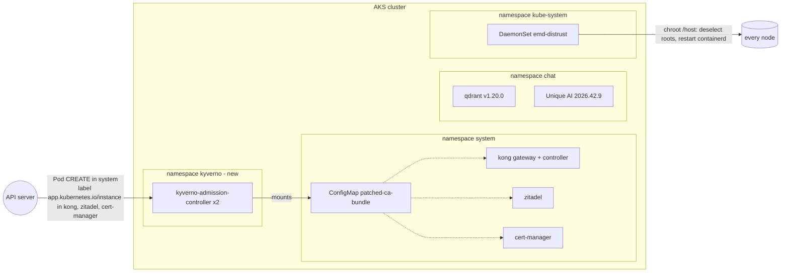

# Release 2026.42 and QTA-10003 (eMudhra CA compromise) on the legacy CMT stack - handbook

This handbook describes what has to happen on a customer-managed tenant (CMT) to

1. close **QTA-10003** (the eMudhra CA compromise) for the third-party components and the AKS nodes,
2. upgrade the Unique AI platform from **2026.38.x** to **2026.42.9**, and
3. upgrade the vector store **Qdrant from 1.15 to 1.20**, one minor version at a time.

It is written for the team that operates the Azure subscription, the AKS cluster and the helmfile deployment.
It complements the release bundle you receive from Unique (`helmfiles/`, `terraform-modules/`, `docs/`): the
bundle contains the configuration, this document contains the order, the manual steps and the checks.

Everything that is a **manual step on your side** (not "take over the config and plan/apply/deploy") is marked
with **[manual]**. Commands use the bundle environment name `your-tenant-alias`; replace it with yours.

Applies to release bundle **2026.42.9**. Read the advisory first:
[QTA-10003 - eMudhra CA Compromise](https://docs.unique.ai/it-operators/operations/support-and-troubleshooting/technical-advisories/qta-10003-emudhra-ca-compromise).

---

## 1. Why this bundle is important and what it changes

On 17 October 2026 the private keys of eight eMudhra intermediate CAs became recoverable. Any program that
still trusts the root `emSign ECC Root CA - G3` (and the cross-signed `AAA Certificate Services`) accepts a
forged certificate for any host name when an attacker sits on the network path. Browsers were fixed within
hours; **containers were not**: the trust store is baked into every image, a pod restart pulls the same image,
and a host patch does not reach the containers.

Your deployment is affected if its workloads reach the internet directly or through a proxy that does not
terminate TLS (CONNECT tunnel). The workloads that matter are the ones holding credentials for outbound TLS:
the API gateway (Kong), the identity provider (Zitadel), the certificate controller (cert-manager), and the
Unique AI services themselves (model provider keys, storage, registry).

The bundle fixes the three layers the advisory describes:

| Layer | Component(s) in this bundle | What the bundle does |
| --- | --- | --- |
| Unique AI application images | all `backend-service-*`, `web-app-*`, `ai-service-*`, `unique/*` images | **Release 2026.42.9** - rebuilt on base images with a corrected CA bundle and the Node.js October 2026 security releases (Node.js has its own root store; only a rebuilt image fixes it). |
| Third-party images without a fixed upstream build | Kong 3.9.x, Zitadel v3.4.15, cert-manager 1.18.2 | **Kyverno** (new) + the `inject-patched-ca-bundle` ClusterPolicy: a mutating admission policy that mounts a corrected CA bundle over `/etc/ssl/certs` of these pods when they are created, and points OpenSSL, Go, `requests` and `botocore` at it. |
| Third-party images with a fixed upstream build | Qdrant | **Qdrant v1.20.0** (image rebuilt on Debian 13 with the patched `ca-certificates`), telemetry to `telemetry.qdrant.io` switched off. |
| AKS nodes | Ubuntu 24.04 and Azure Linux 3 node images released before 20/21 October 2026 | **`emd-distrust` DaemonSet** (`kube-system`): removes the compromised roots from the node trust store and restarts `containerd` once (Go caches the roots per process). Same manifest Unique runs on all of its clusters. |

Everything else in the stack either has no public outbound TLS (RabbitMQ, Elasticsearch, the sandbox
controller) or is operated by Microsoft (AKS add-ons in `kube-system`).



### 1.1 Implications of introducing Kyverno

Kyverno is a Kubernetes policy engine. In this bundle it is deliberately installed in its smallest useful
form, and you should know what that means before you apply it:

- **What is installed.** The Kyverno Helm chart `3.9.1` (Kyverno `v1.19.1`, the version Unique runs on its own
  clusters) with **only the admission controller** (2 replicas, ~128 MiB request / 512 MiB limit each). The
  background, cleanup and reports controllers are disabled, no Pod Security policies and no policy reporter
  are installed. It brings its CRDs (`kyverno.io`, `policies.kyverno.io`, `reports.kyverno.io`,
  `wgpolicyk8s.io`), a ClusterRole for the admission controller and one `MutatingWebhookConfiguration` /
  `ValidatingWebhookConfiguration` pair that Kyverno manages itself.
- **Namespace.** Kyverno runs in its own namespace `kyverno`. Kyverno excludes its own namespace and
  `kube-system` from its webhooks, which is why it must not be installed into `system` where the workloads
  it has to mutate live. The AKS admission enforcer is told to leave the webhook alone
  (`admissions.enforcer/disabled: "true"`).
- **Blast radius.** The only policy is `inject-patched-ca-bundle`. It matches Pod **CREATE** in namespace
  `system` with label `app.kubernetes.io/instance` in `kong`, `zitadel`, `cert-manager`, and it only
  **mutates** (adds a volume, a mount and four environment variables). Nothing is validated or denied.
  The policy has `failurePolicy: Ignore`: if Kyverno is down, pods are created unchanged (then without the
  patched bundle - section 5.4 shows how to detect that). `autogen-controllers: none` keeps the
  Deployments as rendered by their charts, so `helmfile diff` stays clean.
- **Running pods are not touched.** Kyverno mutates at creation time only. After the first apply you must
  restart the targeted workloads (section 5.3). Pods that were mutated keep a reference to the
  `patched-ca-bundle` ConfigMap, which is therefore marked `helm.sh/resource-policy: keep`: it survives a
  removal of the release so that such pods can still restart.
- **Egress.** Kyverno images come from `reg.kyverno.io` (admission controller, `kyvernopre` init container)
  and `ghcr.io/kyverno` (hook jobs); the DaemonSet image from `mcr.microsoft.com`; the chart from
  `https://kyverno.github.io/kyverno/`. Allow them if you filter egress or mirror them into your registry
  (`global.image.registry` in the kyverno release).

---

## 2. Prerequisites checklist

### 2.1 Access and tooling

- [ ] `kubectl` against the AKS cluster (cluster-admin), `helm` >= 3.14 with the `helm-diff` plugin,
      `helmfile` >= 0.160, `vals` (the bundle resolves `ref+azurekeyvault://` secrets), `jq`, `curl`, `openssl`.
- [ ] `helm registry login uniquecr.azurecr.io` with your pull credentials (the `oci://` charts of
      `chat.yaml` and `conduct.yaml`). Unique verified that every image and chart of 2026.42.9 is pullable
      with the standard pull credentials.
- [ ] The release bundle `2026.42.9` checked out next to your tenant values. Files that are new or changed
      compared to `2026.38.2` are listed in section 4.
- [ ] A maintenance window of about **2 hours** (most of it Qdrant rollouts) and a smoke tester for the
      platform (chat, knowledge upload, an HTML preview, Conduct if enabled).

### 2.2 Egress from the cluster [manual]

The platform already pulls from `uniquecr.azurecr.io`, `ghcr.io/unique-ag`, `docker.io`, `quay.io`,
`registry.k8s.io` and `mcr.microsoft.com`. New in this bundle:

| Destination | Used by |
| --- | --- |
| `https://kyverno.github.io/kyverno/` | helm chart repository (`system.yaml`) |
| `reg.kyverno.io` | Kyverno admission controller images |
| `ghcr.io/kyverno` | Kyverno hook jobs (`readiness-checker`) |
| `docker.io/qdrant/qdrant` | Qdrant `v1.16.3` ... `v1.20.0` (already used today) |
| `https://curl.se/ca/` | only if you want to re-download and verify the CA bundle yourself (section 2.4) |

### 2.3 Node pools [manual]

Record the node image versions - they decide how long the DaemonSet has to stay:

```bash
kubectl get nodes -L kubernetes.azure.com/node-image-version -L kubernetes.azure.com/os-sku
```

Ubuntu images up to `AKSUbuntu-2404gen2containerd-202610.08.0`, and Azure Linux images with
`ca-certificates` < `3.0.0-17`, still trust the compromised roots. `AKSUbuntu-2404gen2containerd-202610.23.0`
and newer ship `ca-certificates 20260816ubuntu0.24.04.1` (USN-8944-1 of 20 October 2026, verified in the AKS
VHD release notes), i.e. they are clean. On a clean node the DaemonSet changes nothing and only logs its
`RESULT:` line; on an older node it fixes the trust store in place and restarts `containerd` once. A node
image upgrade (`az aks nodepool upgrade --node-image-only`) is the permanent fix; once every pool runs a clean
image, set `nodeMitigations.emudhraDistrust.enabled: false` and apply `system.yaml`.

### 2.4 The CA bundle

`helmfiles/files/cacert-2026-10-20.pem` is the Mozilla trust store published by the curl project after the
incident, byte-identical to what Unique installed on its own clusters:

```bash
shasum -a 256 helmfiles/files/cacert-2026-10-20.pem
# 796f1389bfea13c0ed78f663b765baaff54a508e5483786bd6ece73c5e3e3cbe
curl -fsSLO https://curl.se/ca/cacert-2026-10-20.pem.sha256 && sha256sum -c cacert-2026-10-20.pem.sha256   # optional re-check
openssl crl2pkcs7 -nocrl -certfile helmfiles/files/cacert-2026-10-20.pem | openssl pkcs7 -print_certs -noout \
  | grep -ci 'emSign ECC Root CA - G3'   # must print 0
```

> **TLS-inspecting proxy with a private CA?** Then this bundle alone breaks every outbound call of the
> targeted pods. Concatenate your CA to a copy of the file and point `caBundleInjection.bundleFile` at it:
> `cat helmfiles/files/cacert-2026-10-20.pem your-internal-ca.crt > helmfiles/files/ca-bundle.pem`.
> (If all egress goes through such a proxy you are in the advisory's "safe in practice" row and may schedule
> this bundle as a normal upgrade instead.)

### 2.5 Qdrant [manual]

Qdrant can only be upgraded **one minor version at a time**, landing on the latest patch of every intermediate
minor ([Qdrant upgrade documentation](https://qdrant.tech/documentation/operations/upgrades/)). From `1.15.x`
to `1.20.0` that is five rollouts. The rollout is zero-downtime only if every collection has
`replication_factor >= 2`. Check and snapshot first (release name `qdrant-zrs`, or your `qdrant.releaseName`):

```bash
# with the port-forward helper `qd` from the end of this section
qd /collections | jq -r '.result.collections[].name' \
  | while read c; do echo "$c rf=$(qd /collections/$c | jq .result.config.params.replication_factor)"; done
qd /cluster | jq '.result.status, (.result.peers | length)'
# snapshot every collection (stored on the pod's PVC under /qdrant/snapshots; copy them off the cluster if you want a real backup)
qd /collections | jq -r '.result.collections[].name' \
  | while read c; do qd "/collections/$c/snapshots?wait=true" -X POST | jq -c '.result.name'; done
```

A collection with `replication_factor: 1` means a short search outage during each rollout - schedule
accordingly. `replication_factor` is set by `nodeIngestion.env.REPLICATION_FACTOR` (bundle default `2`) when a
collection is created and does not change for existing collections.

The Qdrant image ships no shell tools, so all Qdrant checks in this handbook go through a port-forward from
the machine you run `kubectl` on (`qd` is used below as the helper):

```bash
Q=qdrant-zrs   # your qdrant.releaseName
kubectl -n chat port-forward pod/$Q-0 6333:6333 >/dev/null 2>&1 &
qd() { curl -s "http://localhost:6333$1" "${@:2}"; }
# ... when done: kill %1
```

---

## 3. Rollout overview

Do the steps in this order. Steps 1-3 close the vulnerability for the third-party layer and the nodes without
touching the Unique AI release; step 4 upgrades Qdrant; step 5 brings the application images.

| # | Step | Helmfile / file | Downtime | Section |
| --- | --- | --- | --- | --- |
| 1 | Take over the bundle, review the diff against your helmfiles | all | none | 4 |
| 2 | Kong: allow credentialed CORS (reflector) | your `system/kong.yaml` | none | 5.1 |
| 3 | Kyverno + CA-bundle injection + node DaemonSet, restart Kong/Zitadel/cert-manager, verify | `system.yaml` | none (rolling restarts; containerd restart per node) | 5.2-5.4 |
| 4 | Qdrant 1.15 -> 1.16.3 -> 1.17.1 -> 1.18.3 -> 1.19.2 -> 1.20.0 | `chat.yaml -l name=<qdrant>` | none with RF >= 2 | 6 |
| 5 | Platform 2026.42.9: `chat.yaml`, `app-repo.yaml`, `conduct.yaml` | | rolling | 7 |
| 6 | Verification: injection and node checks (5.4), platform smoke test (login, knowledge-base question, upload, HTML preview, Code Execution, Conduct, Admin) | | | 5.4, 7.2 |

If your environment runs the optional `gatekeeper` service, deploy `backend-service-chat`, then `backend-service-scope-management`, then `gatekeeper`, then the rest (2026.42 infrastructure notes); the legacy bundle does not deploy `gatekeeper`.

---

## 4. Step 1 - Take over the bundle

Compared to `2026.38.2` the bundle changes `helmfiles/defaults/01_system.defaults.yaml` (new `kyverno`,
`caBundleInjection`, `nodeMitigations` keys), `helmfiles/examples/system.yaml` (three new releases), the new
`helmfiles/files/cacert-2026-10-20.pem`, the chat/app-repo/conduct defaults (`2026.42.9`, Qdrant `1.20.0`,
Code Execution setting) and `helmfiles/examples/chat.yaml` (Qdrant env, Code Execution setting,
`SCOPE_MANAGEMENT_URL`). Diff them against your copies and take the changes over; your tenant values file
(`your-tenant-alias.yaml`) needs the Code Execution edit from section 7.1. Feature flags that the previous
bundle set and this one no longer maps (retired upstream) leave the ConfigMaps on the first apply.

---

## 5. Steps 2-3 - Kong CORS, Kyverno, CA-bundle injection, node DaemonSet

### 5.1 Kong: allow credentialed CORS for the reflector [manual]

Since 2026.40 the reflector (HTML previews on `reflector.<your host>`) authenticates the browser with cookies.
Its cross-origin preflights from the chat app now need `Access-Control-Allow-Credentials`. The
`backend-service` chart cannot attach a route-level Kong plugin, so set it on your global CORS plugin in
`helmfiles/examples/system/kong.yaml` (the only allowed origin is your own frontend, which is what makes this
safe):

```yaml
        - apiVersion: configuration.konghq.com/v1
          kind: KongClusterPlugin
          metadata:
            name: unique-global-cors
            labels:
              global: "true"
          plugin: cors
          config:
            origins:
              - https://{{ .Values.params.zoneName }}
            credentials: true   # new
            max_age: 600        # new
```

```bash
cd helmfiles/examples/system
helmfile -e your-tenant-alias -f kong.yaml -l name=kong-cluster-plugins diff
helmfile -e your-tenant-alias -f kong.yaml -l name=kong-cluster-plugins apply
```

Kong picks the change up without a restart. Without it, HTML previews in chat fail with a CORS error after
step 5 (visible in the browser console as a blocked preflight to `reflector.<host>`).

### 5.2 Deploy Kyverno, the policy and the DaemonSet

```bash
cd helmfiles/examples
helmfile -e your-tenant-alias -f system.yaml diff --skip-diff-on-install    # kyverno + policy are new, everything else must show no change
helmfile -e your-tenant-alias -f system.yaml apply --skip-diff-on-install
```

`kyverno` is installed first (`wait: true`, up to 10 minutes on a slow pull), then the policy release, then
the DaemonSet. Expected objects:

```bash
kubectl -n kyverno get deploy,pods                                  # kyverno-admission-controller 2/2
kubectl get clusterpolicy inject-patched-ca-bundle                  # READY column True (the deprecation warning about kyverno.io/v1 is expected)
kubectl get clusterpolicy inject-patched-ca-bundle -o jsonpath='{.status.conditions[?(@.type=="Ready")].status}{"\n"}'   # True
kubectl -n system get configmap patched-ca-bundle -o jsonpath='{.data.ca-bundle\.pem}' | grep -c 'BEGIN CERTIFICATE'     # 118
kubectl -n kube-system get ds emd-distrust                          # DESIRED == READY == number of linux nodes
kubectl get mutatingwebhookconfigurations | grep kyverno            # kyverno-resource-, kyverno-policy-, kyverno-verify-mutating-webhook-cfg
```

### 5.3 Restart the targets [manual]

Kyverno only mutates pods that are created after the policy exists:

```bash
kubectl -n system rollout restart deploy/kong-gateway deploy/kong-controller
kubectl -n system rollout restart deploy/zitadel
kubectl -n system rollout restart deploy/cert-manager deploy/cert-manager-cainjector deploy/cert-manager-webhook
kubectl -n system rollout status deploy/kong-gateway deploy/zitadel deploy/cert-manager --timeout=10m
```

(`kong-gateway`/`kong-controller` are the names the `kong/ingress` chart renders for release `kong`; adjust
if yours differ.) Expect a login round trip to fail for a few seconds while Zitadel restarts.

### 5.4 Verify the injection and the nodes

Every targeted pod must carry the volume, every other pod in `system` must not:

```bash
kubectl -n system get pods -o json \
  | jq -r '.items[] | "\(.metadata.name) \(any(.spec.volumes[]?; .name=="patched-ca-bundle"))"'
```

Offline test inside the real Kong pod (its image has `ls` and `grep`, but no `curl`): the mounted directory
must contain exactly the 118 roots of the bundle and no per-root file of the bad CA:

```bash
POD=$(kubectl -n system get pod -l app.kubernetes.io/instance=kong,app.kubernetes.io/name=gateway -o jsonpath='{.items[0].metadata.name}')
kubectl -n system exec $POD -c proxy -- sh -c 'ls /etc/ssl/certs | grep -ci emSign_ECC_Root_CA_-_G3; grep -c "BEGIN CERTIFICATE" /etc/ssl/certs/ca-certificates.crt; echo $SSL_CERT_FILE'
#   0, 118, /etc/ssl/certs/ca-certificates.crt
```

Functional test of the injection path: start a throwaway pod **with the Kong label in `system`**, so Kyverno
mutates it exactly like the real pods, and call the advisory's test host (it presents a certificate from one
of the compromised intermediates; a corrected container must refuse it - **look at the exit code, not at
success/failure**):

```bash
kubectl -n system run qta-10003-check --rm -i --restart=Never --labels=app.kubernetes.io/instance=kong \
  --image=docker.io/curlimages/curl:latest --command -- sh -c \
  'ls /etc/ssl/certs | grep -ci emSign_ECC_Root_CA_-_G3; curl -sS --max-time 10 -o /dev/null https://dv-g3b-emudhra.we-have-a-problem.com/; echo "exit=$?"'
#   0        -> the mutation happened (no per-root file of the bad CA in the mounted directory)
#   exit=60  -> SAFE (certificate verification failed, as it must)
#   exit=0   -> NOT SAFE (the bad chain was accepted; the pod was not mutated - check Kyverno)
#   other    -> no result (DNS/egress to the test host blocked), rely on the offline test
```

Zitadel's and cert-manager's images have no shell; for them the volume check above and the env vars are the
evidence (`kubectl -n system get pod -l app.kubernetes.io/instance=zitadel -o jsonpath='{.items[0].spec.containers[0].env}' | jq -c 'map(select(.name|test("SSL_CERT")))'`).

Nodes - every pod of the DaemonSet must log the success line, each node restarts `containerd` once (running
containers survive it):

```bash
for p in $(kubectl -n kube-system get pods -l app=emd-distrust -o name); do echo "== $p"; kubectl -n kube-system logs $p | grep -E 'RESULT|trust store|Restarting'; done
#   RESULT: node no longer trusts the distrusted eMudhra roots
```

---

## 6. Step 4 - Qdrant 1.15 -> 1.20, one minor at a time

The bundle defaults already point at the target (`qdrant.chart.version: 1.20.0`, `qdrant.imageTag: v1.20.0`).
Step through the intermediate versions by overriding both keys for each `helmfile apply` of the Qdrant release
only. Wait for the StatefulSet rollout and check the cluster between steps.

You can use this script or do it manually one version after the other (basically just the part inside the loop).

```bash
cd helmfiles/examples
Q=qdrant-zrs   # your qdrant.releaseName
for v in 1.16.3 1.17.1 1.18.3 1.19.2 1.20.0; do
  echo "=== Qdrant -> $v ==="
  helmfile -e your-tenant-alias -f chat.yaml -l name=$Q \
    --state-values-set qdrant.chart.version=$v --state-values-set qdrant.imageTag=v$v apply
  kubectl -n chat rollout status statefulset/$Q --timeout=30m
  kubectl -n chat port-forward pod/$Q-0 6333:6333 >/dev/null 2>&1 & sleep 2
  qd() { curl -s "http://localhost:6333$1" "${@:2}"; }
  qd / | jq -r .version                                   # == v
  qd /cluster | jq -r '.result.status'                    # enabled
  qd /collections | jq -r '.result.collections[].name' \
    | while read c; do echo "$c $(qd /collections/$c | jq -r .result.status)"; done   # all green
  kill %1
  read -p "Chat search works? press enter for the next step"
done
```

Notes:

- The last iteration (`1.20.0`) equals the bundle defaults; afterwards `helmfile -f chat.yaml diff` shows no
  change for Qdrant. Do not run the full `chat.yaml apply` before the Qdrant steps are done, or Qdrant would
  jump straight to 1.20.0.
- The StatefulSet restarts pods one at a time (highest ordinal first). The startup probe allows 15 minutes per
  pod for a WAL/index rebuild; the first start on a new minor can take a few minutes on large collections.
- `yellow` collection status during a rollout is normal (a replica is catching up); wait for `green` before
  the next step. `red` or a pod in `CrashLoopBackOff`: stop, read the pod log, roll back by re-applying the
  previous version (same command with the previous `v`) - Qdrant supports a downgrade by one minor.
- Unique AI talks to Qdrant through its REST API (no client SDK pinned to a Qdrant version); 2026.42.9 runs
  against Qdrant 1.20.0 on all Unique-hosted tenants.

---

## 7. Step 5 - Platform release 2026.42.9

### 7.1 Tenant values [manual]

Edit `your-tenant-alias.yaml`:

- **Code Execution** moved from the feature flag `FEATURE_FLAG_ENABLE_CODE_EXECUTION_UN_17498` (still accepted,
  ignored) to the company setting `codeExecutionEnabled`, seeded by `configuration-backend` on every start:

  ```yaml
  chat:
    configurationBackend:
      env:
        COMPANY_CONFIGURATION_CODE_EXECUTION_ENABLED: "*:true"   # every company; or "<companyId>:true;<companyId>:true"
  ```

  Without it the Code Execution tool disappears after the upgrade. `*:true` writes a deployment-wide default
  that an admin can still switch per company; `<companyId>:true` is re-applied on every restart and overrides
  admin changes. It requires `FEATURE_FLAG_USE_OPENAI_V1_13819: "true"` and Azure OpenAI models.

### 7.2 Deploy

Deploy `node-scope-management` first and wait for its rollout. The node-ingestion data migration of 2026.42
(`move_user_homes_under_home_root`) calls a scope-management mutation that only exists from 2026.40 on
(`ensureUserHomeMetadata`); if scope-management is still on 2026.38 when the ingestion migration job runs, the
job fails once with `Cannot query field "ensureUserHomeMetadata"` and Kubernetes retries it until
scope-management is up (on sb-camastral the retry one minute later succeeded; the failed pod stays visible as
`Error` next to the completed job). Deploying in order avoids the noise:

```bash
cd helmfiles/examples
helmfile -e your-tenant-alias -f chat.yaml diff      # image tags 2026.38.2 -> 2026.42.9, configuration-backend env, worker env, retired flags leaving; Qdrant: no change
helmfile -e your-tenant-alias -f chat.yaml -l name=node-scope-management apply
kubectl -n chat rollout status deploy/node-scope-management --timeout=10m
helmfile -e your-tenant-alias -f chat.yaml apply
helmfile -e your-tenant-alias -f app-repo.yaml diff
helmfile -e your-tenant-alias -f app-repo.yaml apply
helmfile -e your-tenant-alias -f conduct.yaml diff   # only when Conduct is deployed; sbx-gateway/sbx-storage/sbx-templates -> 2026.42.9
helmfile -e your-tenant-alias -f conduct.yaml apply
```

The Zitadel release in `chat.yaml` shows no change (you restarted it in step 3; its pods are already mutated).
The database migrations run as Helm pre-upgrade hooks per service, as before. `conduct.yaml` recreates the warm
pool sandbox with the new runtime image (`updateStrategy: Recreate`); a running user session on the old
sandbox ends.

---

## 8. Further reading

- [QTA-10003 - eMudhra CA Compromise](https://docs.unique.ai/it-operators/operations/support-and-troubleshooting/technical-advisories/qta-10003-emudhra-ca-compromise)
- [Release 2026.40 - Infrastructure changes](https://docs.unique.ai/it-operators/installing-and-upgrading-unique/release-notes-and-calendar/release-notes-2026/release-2026-40/2026-40-infrastructure-changes)
- [Release 2026.42 - Infrastructure changes](https://docs.unique.ai/it-operators/installing-and-upgrading-unique/release-notes-and-calendar/release-notes-2026/release-2026-42/2026-42-infrastructure-changes)
- [Qdrant - Upgrades](https://qdrant.tech/documentation/operations/upgrades/)
- [Kyverno - Mutate rules](https://kyverno.io/docs/policy-types/cluster-policy/mutate/), [Kyverno Helm chart](https://github.com/kyverno/kyverno/tree/main/charts/kyverno)
- [curl CA extract](https://curl.se/docs/caextract.html)
- `docs/conduct-handbook.md` (Conduct prerequisites, deploy order, smoke tests T1-T7)
